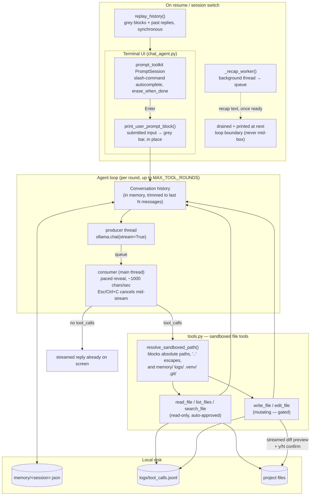

# Forge

A terminal-based AI chat agent backed by a **local Ollama model** — persistent memory, multi-session support, sandboxed file tool-calling with human-in-the-loop approval, and a polished `prompt_toolkit`-driven terminal UI.

Everything runs on your machine. No API keys, no cloud calls — just your local Ollama server and a plain JSON memory store on disk.


<!--
  TODO: record a short demo GIF and drop it at docs/demo.gif, then this line will render it.
  Quick way to make one on macOS:
    1. brew install asciinema agg
    2. asciinema rec docs/demo.cast          # record a short session, then Ctrl+D to stop
    3. agg docs/demo.cast docs/demo.gif       # convert the recording to a GIF
-->

## Features

- **Local-first** — talks to a locally running [Ollama](https://ollama.com) model; no data leaves your machine.
- **Persistent memory** — every session's conversation history is saved to `memory/<session>.json` and reloaded automatically.
- **Multiple sessions** — switch, list, and rename sessions without losing context on any of them. Switching sessions prints a clear visual banner marking the boundary.
- **Session replay on resume** — resuming a session (or switching to one) replays its entire past conversation, then caps it off with a short model-generated recap, so you're never dropped back in cold. See [Session replay & recap](#session-replay--recap).
- **Streaming replies** — the agent's text streams in progressively, at a smooth, evenly-paced rate, instead of appearing all at once — so long replies read naturally from the top instead of jumping straight to the tail end. See [Streaming](#streaming).
- **Tool-calling with safety guardrails** — the model can list, search, read, write, and edit files, but every mutating action (`write_file`, `edit_file`) is sandboxed to the project directory, shown to you as a colored, streamed diff with a detailed change summary, and requires explicit `y/N` confirmation before it runs.
- **Full audit trail** — every tool call (approved, declined, or failed) is logged to `logs/tool_calls.jsonl` with arguments, timing, and outcome.
- **Polished terminal UX** — slash-command autocomplete, a live "Thinking… (Ns)" indicator, Esc/Ctrl+C to interrupt a generation at any point — including mid-stream — with your message restored to the prompt box (not lost), and Alt+Enter/Shift+Enter for multi-line input.

## Architecture



Every turn: your message immediately flips to a grey block (before generation even starts), gets appended to history and saved, then sent to Ollama with `stream=True` alongside the available tool schemas. A background producer thread pulls chunks off the stream and formats them incrementally; the main thread reveals them at a steady, paced rate rather than printing whatever arrives the instant it arrives. The loop keeps feeding tool results back to the model (up to `MAX_TOOL_ROUNDS`) until a round returns no tool calls, at which point that round's streamed text *is* the final reply — there's no separate "print the reply" step afterward.

## Requirements

- Python 3.10+
- [Ollama](https://ollama.com) installed and running locally
- A pulled model (default: `qwen3.5:9b`)

## Installation

```bash
git clone git@github.com:HarishKumar-2004/Forge.git
cd Forge
python3 -m venv .venv
source .venv/bin/activate
pip install -r requirements.txt
```

Pull the default model (or any model you plan to use):

```bash
ollama pull qwen3.5:9b
```

Make sure the Ollama server is running (`ollama serve`, or just open the Ollama app) before starting the agent.

## Usage

```bash
source .venv/bin/activate
python chat_agent.py
```

| Flag | Description |
|---|---|
| `--model NAME` | Use a specific Ollama model (default: `qwen3.5:9b`) |
| `--resume NAME` | Resume an existing named session (must already exist) |
| `--reset` | Clear the active session's memory before starting |

Type `/exit`, `/quit`, or `/bye` to end the chat. These are slash commands, not plain words — typing a bare `exit`/`quit`/`bye` sends it to the model as an ordinary chat message instead, so you can never accidentally end the session just by saying goodbye to it mid-conversation.

### Slash commands

| Command | Description |
|---|---|
| `/reset` | Clear the active session's memory |
| `/session [name]` | Switch to (or show) the active session — replays its history (see below) the first time you switch to it each run |
| `/sessions` | List all sessions |
| `/rename <name>` | Rename the active session |
| `/model [name]` | Switch to (or show) the active model |
| `/models` | List all installed Ollama models |
| `/exit`, `/quit`, `/bye` | End the chat session |

Typing `/` opens an autocomplete menu for these; it narrows as you keep typing and supports Escape to dismiss.

### Keyboard shortcuts

| Key | Effect |
|---|---|
| `Enter` | Submit (ignored on a blank prompt) |
| `Shift+Enter` or `Alt+Enter` | Insert a newline for a multi-line message |
| `Esc` or `Ctrl+C` (while the agent is generating, including mid-stream) | Cancel the current turn; your message is restored to the prompt box for editing. Any text already streamed stays visible, with `[cancelled]` printed cleanly below it |
| `Esc` (while the slash-command menu is open) | Dismiss the menu |
| `Esc` (while a diff preview is streaming) | Fast-forwards the rest of the preview instantly, without affecting the `y/N` decision that follows |

## Safety guardrails

The model never touches your filesystem directly — every tool call goes through `tools.py`'s sandbox:

- **Path confinement** — `resolve_sandboxed_path()` rejects absolute paths and any path that resolves outside the project root, and blocks `memory/`, `logs/`, `.venv/`, `__pycache__/`, `.git/`, and `node_modules/` outright.
- **Read vs. write separation** — `list_files`, `search_file`, and `read_file` run automatically. `write_file` and `edit_file` always stop first: you see a colored, line-numbered diff of exactly what would change — streamed in progressively rather than dumped all at once — plus a one-line summary (new file vs. overwrite, line counts, lines added/removed, byte size), and must type `y`/`yes` to approve. Decline, and the model is told not to retry the same action unprompted.
- **Size caps** — reads, searches, and writes are all capped (file size, line count, match count) so a single tool call can't blow up your context window or write unbounded data.
- **Full audit log** — `logs/tool_calls.jsonl` records every call: tool name, arguments (truncated), whether it mutated anything, who approved it, outcome, and duration.

## Session replay & recap

Resuming a session with `--resume NAME` (or switching to one with `/session NAME`) doesn't just silently reload its history — it replays the whole thing back to you:

- Every past exchange prints in order: your prompt as a solid, full-width grey background bar (matching Claude Code's own CLI styling for past input), followed by the agent's actual reply underneath it.
- If a turn involved tool calls, only the *final* outcome of that turn is replayed (its last reply, or — if the model gave no closing summary after a successful tool call — a placeholder noting the action completed anyway). The tool calls themselves aren't re-shown; that detail still lives in `logs/tool_calls.jsonl` if you need it.
- Once the full replay finishes, a short model-generated recap (a violet `◆` bullet, italic text, 1-2 sentences) summarizes what the conversation covered and whether anything's left open. This is generated by a background thread so it never blocks the live prompt box from appearing — you can start typing immediately, and the recap prints itself at the next natural pause in the conversation (never mid-box) once it's ready.
- A session is only ever replayed **once per run**: switching back to a session you've already visited this session doesn't re-replay it or regenerate its recap — you just land straight in the live prompt box, with a dim banner (`──── Session: name ────`) marking the switch either way.

Every *new* message you send during the live session gets the same grey-bar treatment the moment it's no longer the active input — not just on replay — so there's never a visual distinction between "something from history" and "something from earlier this run."

## Streaming

Replies stream in progressively instead of appearing all at once. This isn't just raw network output printed as it arrives — Ollama's token generation is bursty, so the agent decouples *receiving* text from *displaying* it: a background thread pulls chunks off the stream and formats them (markdown, word-wrap, code blocks) incrementally, while the main thread reveals the result at a steady, fixed pace, independent of how fast or slow the model is actually generating. If the model gets ahead, the display just becomes the bottleneck; if it falls behind, the display pauses gracefully rather than stuttering.

The same philosophy applies to `write_file`/`edit_file` diff previews — large diffs stream in too, just faster, since a diff isn't prose meant to be read at conversational pace.

Tool-calling rounds are unaffected: a round where the model only calls tools (no reply text) naturally streams nothing, so the existing "Thinking…" indicator and tool-call display are exactly as before.

## Sessions & memory

Each session's history lives in its own `memory/<session>.json` file, created automatically on first use. History is trimmed to the most recent `MAX_HISTORY_MESSAGES` entries per session to keep requests fast. If a turn is interrupted (Esc/Ctrl+C), that turn is rolled back entirely — nothing partial gets saved, even if some reply text had already streamed to the screen before the interrupt.

## Project structure

```
.
├── chat_agent.py   # terminal UI, agent loop, session/memory management
├── tools.py        # sandboxed file tools exposed to the model
├── requirements.txt
├── memory/         # per-session conversation history (gitignored)
├── logs/           # tool-call audit log (gitignored)
└── .venv/          # virtual environment (gitignored)
```
